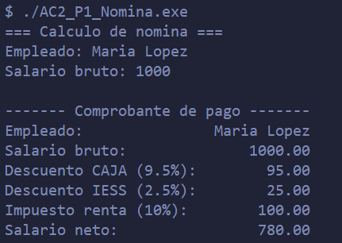
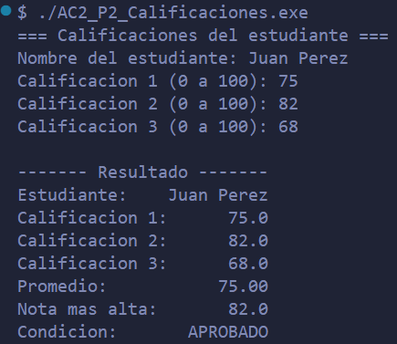

# AC2 · Mi primera aplicación en C

**Estudiante:** Elias Guzman Castro  
**Fecha:** 20/10/2026  
**Módulo:** CSTI12010 Diseño de algoritmos · UA2

## Problema 1 · Nómina (AC2_P1_Nomina.c)

| Datos de entrada             | Proceso                                                                                                                                                                                                                                                                                                                                                                                                                | Datos de salida                                                        | Limitaciones                                                                          |
| ---------------------------- | ---------------------------------------------------------------------------------------------------------------------------------------------------------------------------------------------------------------------------------------------------------------------------------------------------------------------------------------------------------------------------------------------------------------------- | ---------------------------------------------------------------------- | ------------------------------------------------------------------------------------- |
| nombreCompleto, salarioBruto | Se lee el nombre, se lee el salario bruto, si ambos datos estan en dentro de los rangos aceptados entonces, la cantidad de la caja es igual a (salario bruto _ CAJA), la cantidad de la IESS es igual a (salario bruto _ IESS), si el salario bruto es mayor al limite (800) se calcula el iva (10% del salario), sino se queda en 0, finalmente se imprimen los datos que se encuentran en la sección datos de salida | nombreCompleto, salarioBruto, cantCaja, cantIESS, cantIVA, salarioNeto | cantIVA permancera como 0 hasta que salario bruto sea 801, si es 800 permanecera en 0 |

**Ejecución con los datos del ejemplo:**

## Problema 2 · Calificaciones (AC2_P2_Calificaciones.c)

| Datos de entrada                           | Proceso                                                                                                                                                                                                                                                                                                                                                                                                                                                                                                                               | Datos de salida                                                          | Limitaciones                                                                |
| ------------------------------------------ | ------------------------------------------------------------------------------------------------------------------------------------------------------------------------------------------------------------------------------------------------------------------------------------------------------------------------------------------------------------------------------------------------------------------------------------------------------------------------------------------------------------------------------------- | ------------------------------------------------------------------------ | --------------------------------------------------------------------------- |
| nombreCompleto, nota[0], nota[1] y nota[2] | Se lee el nombre, se entra en un ciclo for para los arreglos de notas, en caso de que esten fuera de rango se muestra un mensaje de error, cuando todo esta correcto se calcula el promedio con ayuda de otro ciclo for, tras eso se entra en el determinador de condicion donde si es igual o mayor a 70 la condicion es aprovado, si es menor a 70 y mayor o igual a 60 la condicion es en riesgo, y si es menor a 60 la condición es no aprovado, finalmente se imprimen los datos que se encuentran en la sección datos de salida | nombreCompleto, nota[0], nota[1] y nota[2], promedio, masAlta, condicion | nota[0], nota[1] y nota[2], no pueden ser menores a 0 y tampoco mayores a 3 |

**Ejecución con los datos del ejemplo:**

## Problema 3 · Compras (AC2_P3_Compras.c)

| Datos de entrada | Proceso | Datos de salida | Limitaciones |
| ---------------- | ------- | --------------- | ------------ |
|                  |         |                 |              |

**Ejecución con los datos del ejemplo:**

## Conclusión

(Qué aprendí y qué fue lo más difícil de pasar de PSeInt a C.)
En lo personal me costo mucho aprender sobre fgets, strcpy y strcmp, sin embargo creo que pude comprender su funcionamiento
Por otro lado se me complico en un inicio el acomodar el texto especialmente en la linea 91 del problema 2, donde tuve que hacerlo a prueba y error.
